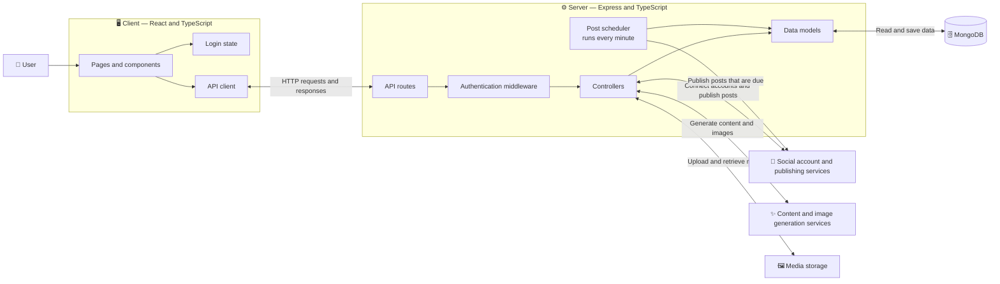

# 🌊 SocialFlow

   ✨ **SocialFlow** streamlines your social media management by allowing you to create engaging content, connect multiple social accounts, and schedule posts—all from one centralized platform.

🌐 **Live Demo**: [https://socialflow2.onrender.com](https://socialflow2.onrender.com)  
📂 **GitHub Repo**: [https://github.com/sahilkumar720/socialFlow](https://github.com/sahilkumar720/socialFlow)  
📧 **Contact**: sahilkumar7369@gmail.com

## ✨ What you can do

- 📝 Create an account and sign in.
- 📊 View your dashboard and recent publishing activity.
- 🔗 Connect and manage social media accounts, including X (Twitter), LinkedIn, Facebook, and Instagram.
- 🤖 Generate social media post content.
- 🖼️ Generate images to go with your posts.
- 🗓️ Schedule posts for connected accounts. The app checks for posts that are ready and publishes them automatically.
- 📎 Attach media to a scheduled post.

## 🧰 Built with

- **Frontend:** React, TypeScript, Vite, Tailwind CSS
- **Backend:** Node.js, Express, TypeScript
- **Database:** MongoDB with Mongoose
- **Integrations:** Zernio, Google Gemini, Leonardo AI, Cloudinary

## Screenshot🖼️
| Page | Screenshot |
| --- | --- |
| Home and live assistant preview |  |
| Dashboard |  |
| Accounts |  |
| Scheduler |  |
| AI Composer |  |
| Choose platform |  | 

## 🏗️ Project architecture

This diagram shows how a request moves through SocialFlow:



In short, the client provides the pages you use, and sends requests to the server. The server checks signed-in requests, runs the app's features, and saves account, post, and activity data in MongoDB. A background scheduler checks for due posts every minute and sends them for publishing.

## 📁 Project layout

```text
socialFlow/
├── client/                  # React web app
│   └── src/
│       ├── components/      # Shared UI components
│       ├── pages/           # Home, login, dashboard, scheduler, composer, accounts
│       ├── api/             # API client
│       └── context/         # Login state
└── server/                  # Express API
    ├── config/              # Database and integration setup
    ├── controllers/         # API request handling
    ├── middlewares/         # Authentication checks
    ├── models/              # MongoDB data models
    ├── routes/              # API endpoints
    └── services/            # Scheduled post publishing
```

## ✅ Requirements

- [Node.js](https://nodejs.org/) and npm
- A MongoDB database
- API credentials for the integrations you want to use (see below)

## 🚀 Run it locally

Install dependencies in each app folder:

```bash
cd server
npm install
cd ../client
npm install
```

Create a `server/.env` file and add the configuration described in [Environment variables](#-environment-variables). You can also create a `client/.env` file if your API is not running at `http://localhost:3000`.

Start the backend in one terminal:

```bash
cd server
npm run server
```

Start the frontend in a second terminal:

```bash
cd client
npm run dev
```

Open the local address printed by Vite in your browser (usually `http://localhost:5173`). The backend uses port `3000` by default.

## ☁️ Deploy the server to Render

Create a Render **Web Service** for this repository and configure it as follows:

| Setting | Value |
| --- | --- |
| Root Directory | `server` |
| Build Command | `npm install && npm run build` |
| Start Command | `npm start` |

The build command compiles the TypeScript files into `server/dist`. The start command runs the compiled JavaScript, including the generated `dist/config/db.js` file, so the server's `.js` imports resolve correctly in production.

**Important:** If Render's deploy log still says `Running 'node server.ts'`, the service is using an old Start Command that overrides `package.json`. In Render, open **Settings → Build & Deploy**, change the Start Command to `npm start`, save the change, and deploy again.

Add the server environment variables from [Environment variables](#-environment-variables) in the Render dashboard. At minimum, set `MONGODB_URI`, `JWT_SECRET`, and `ZERNIO_API_KEY`. Add the AI and media variables for those features. Render provides the `PORT` value automatically.

## 🔐 Environment variables

Add secrets only to local `.env` files. Do not commit real API keys or passwords.

### `server/.env`

```env
PORT=3000
MONGODB_URI=your_mongodb_connection_string
JWT_SECRET=replace_with_a_long_random_secret

ZERNIO_API_KEY=your_zernio_api_key
GEMINI_API_KEY=your_google_gemini_api_key

# Optional: needed for AI-generated images
LEONARDO_API_KEY=your_leonardo_api_key

# Needed for media uploads and saving generated images
CLOUDINARY_CLOUD_NAME=your_cloudinary_cloud_name
CLOUDINARY_API_KEY=your_cloudinary_api_key
CLOUDINARY_API_SECRET=your_cloudinary_api_secret
```

`MONGODB_URI` and `ZERNIO_API_KEY` are needed for the database and social publishing features. `GEMINI_API_KEY` is needed for AI text generation. Leonardo image generation is optional; Cloudinary is used to store uploaded and generated media.

### `client/.env` (optional)

The frontend defaults to `http://localhost:3000` for API requests. To use a different server address, set:

```env
VITE_APi_BASE_URL=http://localhost:3000
```

Keep the variable spelling as shown (`APi`), because that is the name currently used by the frontend.

## 🧭 Main pages

| Page | What it is for |
| --- | --- |
| `/` | Project landing page |
| `/login` | Sign in or create an account |
| `/dashboard` | View the dashboard |
| `/scheduler` | Create and schedule posts |
| `/ai-composer` | Generate social post content |
| `/accounts` | Connect and manage social accounts |

## 🔌 API overview

The backend runs at `http://localhost:3000` by default.

| Route | Purpose |
| --- | --- |
| `POST /api/auth/register` | Create an account |
| `POST /api/auth/login` | Sign in |
| `/api/oauth` | Start social account authorization and sync accounts |
| `/api/accounts` | List, add, or disconnect social accounts |
| `/api/posts` | List posts, schedule a post, or generate content |
| `GET /api/activity` | Get recent account activity |

Most account, post, and activity routes require a signed-in user.

## 🛠️ Useful commands

Run these from the matching `client` or `server` folder:

| Command | Folder | Purpose |
| --- | --- | --- |
| `npm run dev` | `client` | Start the frontend development server |
| `npm run build` | `client` | Type-check and build the frontend |
| `npm run lint` | `client` | Check frontend code style |
| `npm run preview` | `client` | Preview the production frontend build |
| `npm run server` | `server` | Start the backend with automatic reload |
| `npm start` | `server` | Start the backend |
| `npm run build` | `server` | Compile the backend TypeScript |

## 🔒 Keep credentials safe

Both app folders ignore `.env` files through Git. Keep API keys, database credentials, and JWT secrets in local environment files or a secure deployment secret store, never in source code.
